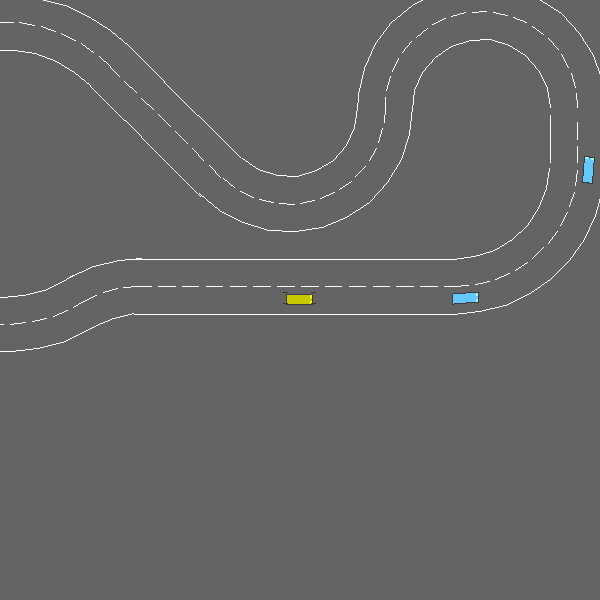

# Racetrack Agent RL Learning

Vroom, Vroom 🏎️

Uczymy agenta jeździć po torze w środowisku `racetrack-v1` z biblioteki [highway-env](https://highway-env.farama.org/) (gymnasium).
Algorytm: **SAC** (stable-baselines3), **akcje ciągłe** – gaz/hamulec + skręt.



## Co jest zrobione

| Plik | Co robi |
|---|---|
| `manual_control.py` | Sterujesz autem strzałkami (↑↓ gaz/hamulec, ←→ skręt) – żeby poczuć środowisko |
| `main.py` | Wizualizacja tego, co „widzi” agent: przeglądarka klatek i siatek obserwacji (suwak / klawisze ←/→) |
| `meta_action_demo.py` | Demo akcji dyskretnych (zmiana pasa, szybciej/wolniej) – ostatecznie wybraliśmy ciągłe |
| `random_agent.py` | Baseline – losowy agent: nagrywa `media/random_agent.gif` + statystyki ze 100 epizodów |
| `random_agent_stats.txt` | Wynik losowego agenta: ~11.5 kroku/epizod, 99% wyjazdów z drogi |
| `train_sac.py` | **Główny trening SAC** |
| `watch_agent.py` | Okno pokazujące jak jeździ najnowszy checkpoint – można odpalić w drugim terminalu w trakcie treningu |
| `random_agent_stats.py` | Pokazuje 10 epizodów agenta losowego lub SAC (`AGENT = "random"/"sac"`), wymaga `sac_racetrack.zip` |
| `checking_model.py` | Kopia `manual_control.py` bez sterowania (auto z zerową akcją) – plik roboczy |

### Jak działa trening (`train_sac.py`)

- **Własna nagroda** (domyślna płaciła za samo stanie w miejscu):
  - \+ za prędkość wzdłuż toru i za jazdę środkiem pasa,
  - − za skręcanie i gwałtowne zmiany skrętu,
  - **−5** za kolizję, wyjazd z drogi albo stanie > 5 s (kończy epizod).
- **Obserwacja** rozszerzona o aktualną prędkość i poprzedni skręt.
- **Curriculum (etapy):** pusty tor → 1 auto → lekki ruch (1–5 aut) → duży ruch (10–20 aut).
  Przejście dalej, gdy średnia długość ostatnich 50 epizodów ≥ 80% maksimum albo po limicie kroków etapu.
  20% epizodów gra się na poprzednim etapie, żeby agent nie zapominał.
- 8 środowisk równolegle (`SubprocVecEnv`), checkpoint co 10k kroków do `sac_checkpoints/`,
  logi w `sac_logs/` (monitor.csv + TensorBoard). Na końcu `sac_racetrack.zip` i wykres `sac_learning_curve.png`.
- Parametry ustawia się **stałymi na górze pliku**: `TIMESTEPS`, `N_ENVS`, `RESUME_FROM`, `START_STAGE`, wagi nagrody.

## Instalacja

Wymagany Python 3.13 i [uv](https://docs.astral.sh/uv/).

```bash
git clone https://github.com/pietraldo/Racetrack_agent.git
cd Racetrack_agent
uv sync
```

> Jeśli w `pyproject.toml` brakuje `stable-baselines3`, `torch`, `pandas`, `tensorboard`, `matplotlib`, doinstaluj je:
> `uv add stable-baselines3 torch pandas tensorboard matplotlib`.
> Pakiety spoza `pyproject.toml` zostaną usunięte przez `uv run` przy synchronizacji – wtedy aktywuj venv
> (`.venv\Scripts\activate`) i uruchamiaj zwykłym `python`.

## Komendy

```bash
# sterowanie ręczne
uv run python manual_control.py

# co widzi agent
uv run python main.py

# baseline – losowy agent (GIF + statystyki)
uv run python random_agent.py

# trening naszego SAC (softactorcritic/) – wyniki w runs/<nazwa>/
python train_sac.py --name A_curriculum_a0.2                     # pusty tor -> 1 auto -> lekki ruch
python train_sac.py --name C_no_curriculum_a0.2 --start-stage 2  # od razu lekki ruch
python train_sac.py --name B_curriculum_a0.05 --alpha 0.05       # inny współczynnik entropii

# podgląd agenta na żywo (w drugim terminalu), domyślnie najnowszy run
python watch_agent.py runs/A_curriculum_a0.2

# krzywe uczenia -> figures/learning_*.png, figures/compare_*.png
python plot_training.py

# ewaluacja końcowa (wszystkie runs/*/final_model.pkl + agent losowy, 4 poziomy ruchu, 30 ep.)
# -> results/eval_summary.md, figures/eval_*.png
python evaluate.py
```

**Trening od zera:** ustaw w `train_sac.py` `RESUME_FROM = None` i `START_STAGE = 0`
(w przeciwnym razie skrypt szuka checkpointu, którego po świeżym klonie nie ma).

## Do wiedzenia

- Modele i logi (`sac_checkpoints/`, `sac_logs/`) **nie są w gicie** (checkpoint ~6 MB) – gotowe modele trzeba przesłać osobno.
- Hack z `torch.load` w kodzie jest celowy – bez niego na Windowsie wczytywanie zipa SB3 się sypie.
- Na Windowsie trening musi być pod `if __name__ == "__main__":` (inaczej `SubprocVecEnv` się wywala).
- Gałąź `highway` to stary eksperyment („highway game”), nie trzeba jej ruszać.
